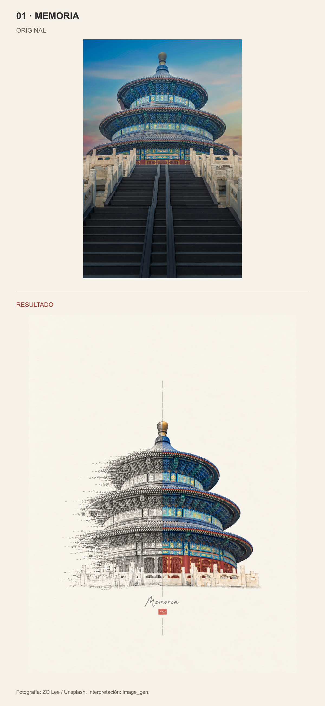
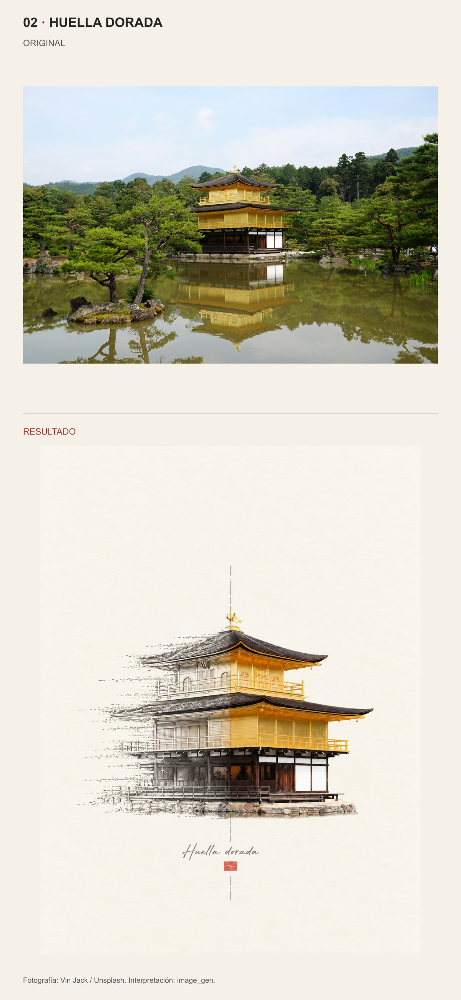
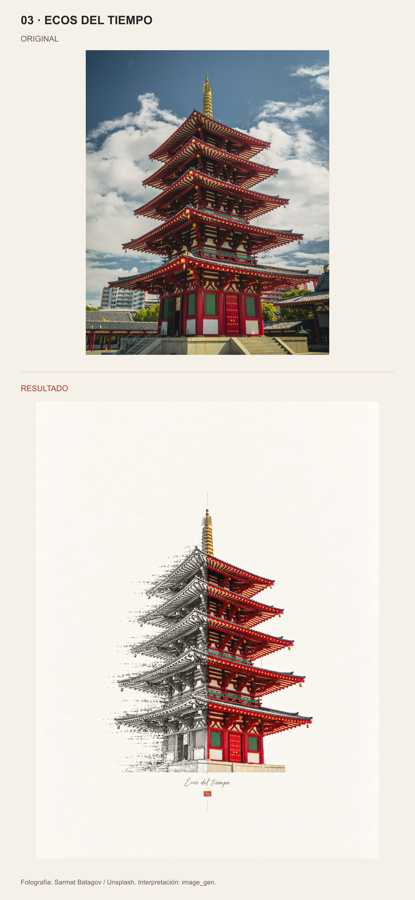

# Arquitectura · Huella de tinta

Tres carteles de mitad fotografía en color y mitad calco de tinta que se desvanece siguiendo la estructura del edificio. Texto visual en español.

Cada comparación muestra el archivo original completo arriba y el cartel completo debajo, con proporciones conservadas.

[Skill](SKILL.md) · [Galería](comparison.html) · [Fuentes](references/sources.md) · [Prompts completos](references/prompts.md) · [Revisión de las muestras](references/review.md)

## 01 · MEMORIA

Fotografía: ZQ Lee / Unsplash. Interpretación: image_gen.

[Fotografía original](references/images/01-temple-of-heaven.jpg) · [Cartel independiente](assets/examples/01-memoria.png)

## 02 · HUELLA DORADA

Fotografía: Vin Jack / Unsplash. Interpretación: image_gen.

[Fotografía original](references/images/02-kinkakuji.jpg) · [Cartel independiente](assets/examples/02-huella.png)

## 03 · ECOS DEL TIEMPO

Fotografía: Sarmat Batagov / Unsplash. Interpretación: image_gen.

[Fotografía original](references/images/03-shitennoji.jpg) · [Cartel independiente](assets/examples/03-ecos.png)

## Uso

La carpeta completa contiene SKILL.md, configuración de interfaz, fuentes, prompts y muestras. Invoca `$architecture-ink-dissolve` con una foto o una petición de búsqueda. Requiere una herramienta de generación de imágenes disponible; no incluye modelos ni claves.

Las muestras son reinterpretaciones generadas, con cambios de microdetalle. No son reconstrucciones documentales ni modelos 3D. Las fotografías mantienen sus derechos y condiciones según la página de fuentes.
