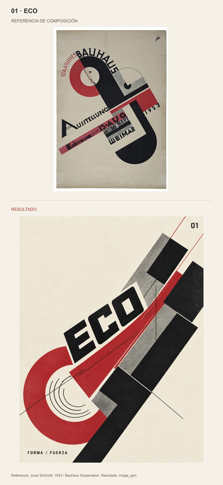
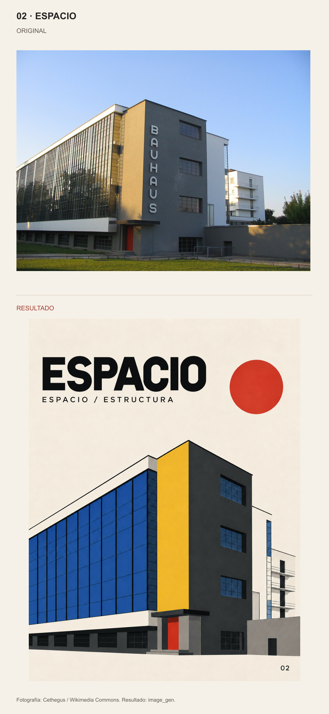
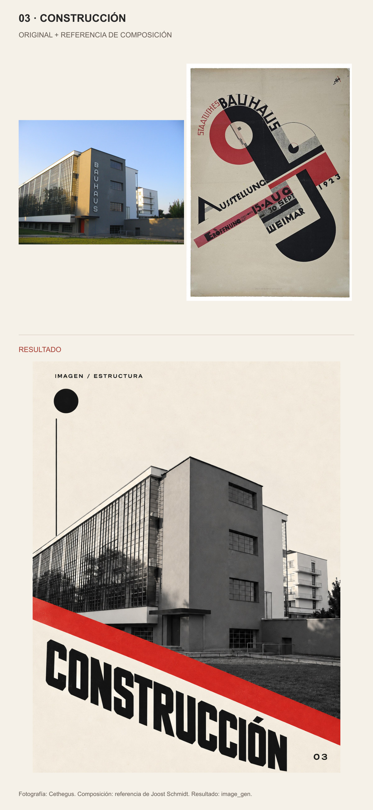
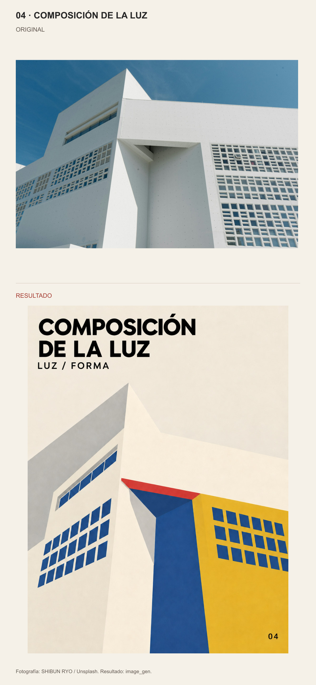
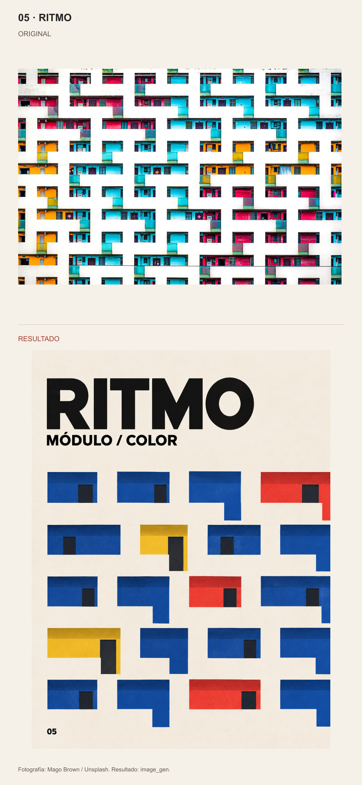
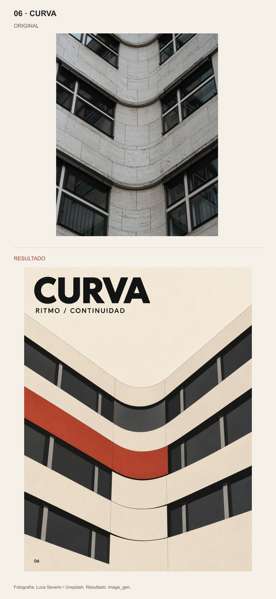
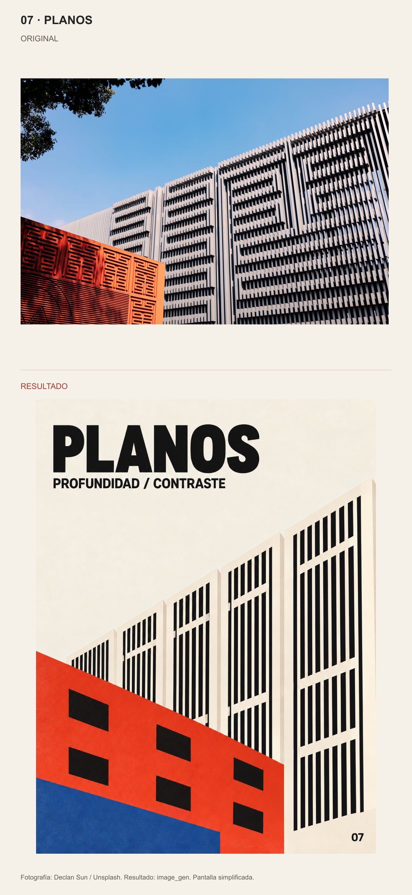

# Bauhaus · Composición espacial

Cada muestra presenta la referencia original arriba y el resultado debajo, sin recortar ni deformar las imágenes. Los rótulos visuales están en español.

[Skill](SKILL.md) · [Galería de comparación](comparison.html)

## 01 · ECO

Referencia: Joost Schmidt, 1923 / Bauhaus Kooperation. Resultado: image_gen.

## 02 · ESPACIO

Fotografía: Cethegus / Wikimedia Commons. Resultado: image_gen.

## 03 · CONSTRUCCIÓN

Fotografía: Cethegus. Composición: referencia de Joost Schmidt. Resultado: image_gen.

## 04 · COMPOSICIÓN DE LA LUZ

Fotografía: SHIBUN RYO / Unsplash. Resultado: image_gen.

## 05 · RITMO

Fotografía: Mago Brown / Unsplash. Resultado: image_gen.

## 06 · CURVA

Fotografía: Luca Severin / Unsplash. Resultado: image_gen.

## 07 · PLANOS

Fotografía: Declan Sun / Unsplash. Resultado: image_gen. Pantalla simplificada.

## Uso

Coloca la carpeta completa de este skill en tu directorio de skills y utiliza `$bauhaus-spatial-posters`. Revisa SKILL.md antes de ejecutarlo. La carpeta no incluye modelos ni credenciales.

Fuentes y condiciones: [referencias actuales](references/spanish-sources.md), [historial de fuentes](references/source-notes.md). Prompts: [serie 05–07](references/series-05-07-prompts.md), [adaptación al español](references/spanish-prompts.md), [composiciones iniciales](references/prompts.md).
