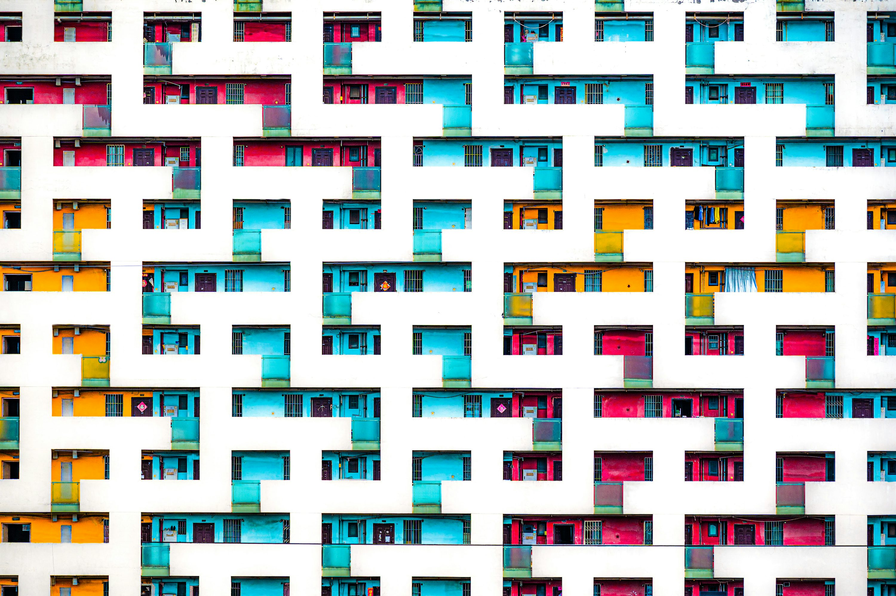
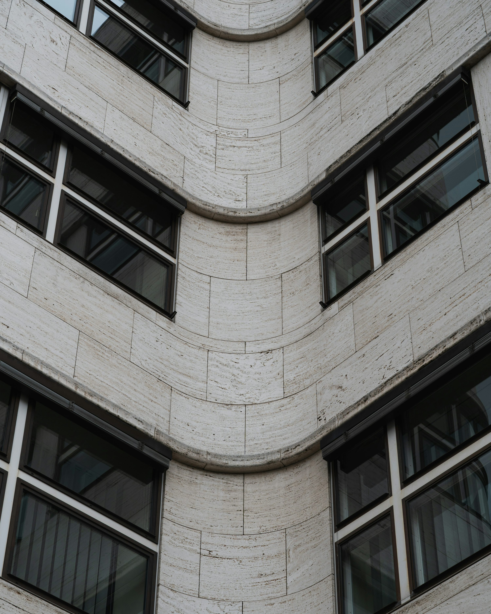
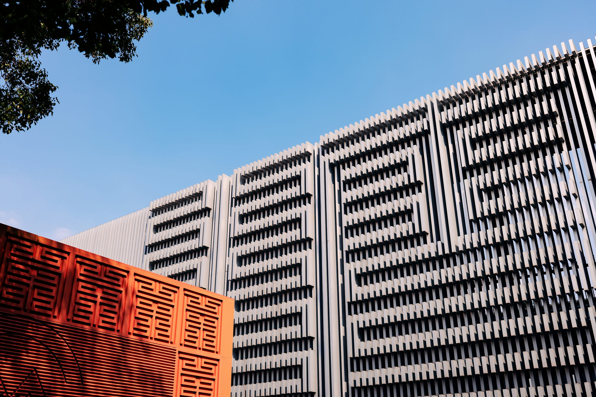

# Fotografías y referencias

Fecha de consulta: 2026-10-25.

## Tres fotografías nuevas

### 1. Balcones de colores

- Fotografía: **Mago Brown**.
- [Página original en Unsplash](https://unsplash.com/photos/colorful-balconies-form-a-geometric-pattern-on-building-B3y-Uz9DLS0).
- [Archivo local](../references/images/01-balcones.jpg).
- La página indica uso bajo la [licencia Unsplash](https://unsplash.com/license). No es una declaración de dominio público ni una licencia Creative Commons.
- Criterio de selección: grandes franjas blancas, vacíos repetidos y acentos de color; útil para estudiar ritmo modular y equilibrio cromático.

### 2. Fachada curva en Berlín

- Fotografía: **Luca Severin**.
- [Página original en Unsplash](https://unsplash.com/photos/curved-concrete-building-facade-with-repeating-windows-v5b5_v3_dyQ).
- [Archivo local](../references/images/02-curva.jpg).
- La página indica uso bajo la [licencia Unsplash](https://unsplash.com/license).
- Criterio de selección: continuidad curva y repetición de ventanas; amplía los temas disponibles más allá de los volúmenes ortogonales.

### 3. Planos rojos y blancos en Shanghái

- Fotografía: **Declan Sun**.
- [Página original en Unsplash](https://unsplash.com/photos/modern-building-facade-with-geometric-patterns-C0zw-GkWHOc).
- [Archivo local](../references/images/03-planos-rojos.jpg).
- La página indica uso bajo la [licencia Unsplash](https://unsplash.com/license).
- Criterio de selección: contraste entre una pantalla roja próxima y una fachada blanca de ritmo vertical; útil para explorar profundidad mediante capas.

Las tres fotografías se guardaron tal como las devolvió el servicio de imágenes, sin edición local de sus píxeles. Son referencias fotográficas reales, no resultados generados. No se atribuyen arquitectos ni nombres de edificios no confirmados por las páginas.

## Procedencia de los carteles existentes

- ECO: adaptación gráfica original basada en las relaciones de color y composición del cartel de **Joost Schmidt**, 1923; [Bauhaus Kooperation](https://bauhauskooperation.de/wissen/das-bauhaus/werke/graphische-druckerei/plakat-zur-bauhaus-ausstellung-in-weimar-1923). La fuente identifica la imagen histórica como Bauhaus-Archiv Berlin / gemeinfrei / abgelaufen 2018.
- ESPACIO y CONSTRUCCIÓN: versiones generativas de una fotografía de la Bauhaus Dessau por **Cethegus**; [página del archivo en Wikimedia Commons](https://commons.wikimedia.org/wiki/File:Bauhaus-Dessau_main_building.jpg). El fotógrafo incluye una declaración de dedicación al dominio público. CONSTRUCCIÓN también utiliza las relaciones compositivas del cartel de Schmidt como referencia.
- COMPOSICIÓN DE LA LUZ: versión geométrica generada a partir de una fotografía del centro cultural Boduhe, Wuxi, por **SHIBUN RYO**; [página original en Unsplash](https://unsplash.com/photos/modern-white-building-with-geometric-patterns-oESACGRB2QM), bajo la licencia Unsplash.

Los carteles no son reproducciones documentales exactas de los edificios ni obras históricas originales. Las referencias conservan sus condiciones y créditos propios; no se ha elegido una licencia global para todos los materiales de esta colección.

## Uso en la edición 03

Las tres fotografías anteriores ya se utilizaron como referencias de RITMO, CURVA y PLANOS, respectivamente. Consulta la [revisión de resultados y sus prompts](series-05-07-prompts.md). La versión final de PLANOS sustituye los motivos de la pantalla roja por seis huecos rectangulares, para evitar texto ajeno al español.
