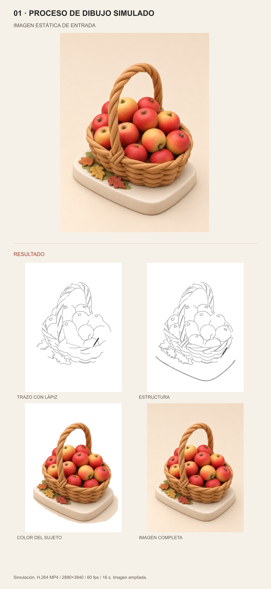

# Proceso de dibujo simulado

Cada muestra presenta la referencia original arriba y el resultado debajo, sin recortar ni deformar las imágenes. Los rótulos visuales están en español.

[Skill](SKILL.md) · [Galería de comparación](comparison.html)

[Ver vídeo de previsualización](assets/examples/01-process-preview.mp4) · [Descargar MP4 4K 60fps](assets/examples/01-process-4k60.mp4) · [Parámetros verificados](assets/examples/01-process-4k60.json)

Este vídeo infiere contornos y simula la aparición del color. No es una grabación del proceso real de un artista. La salida se amplió desde una entrada de 1086×1448 y un trabajo de 768×1024.

## 01 · PROCESO DE DIBUJO SIMULADO

Simulación. H.264 MP4 / 2880×3840 / 60 fps / 16 s. Imagen ampliada.

## Uso

Coloca la carpeta completa de este skill en tu directorio de skills y utiliza `$paint-process-video`. Revisa SKILL.md antes de ejecutarlo. La carpeta no incluye modelos ni credenciales.

[Revisión de la muestra](references/sample-validation.md) · [Dependencias](requirements.txt) · [Script de render](scripts/render_process.py). FFmpeg y FFprobe deben estar disponibles en PATH.
