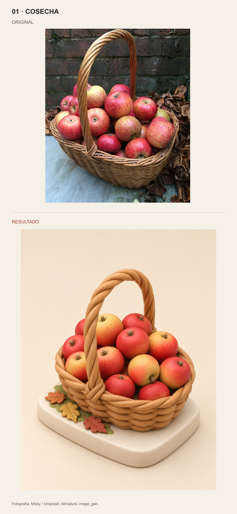
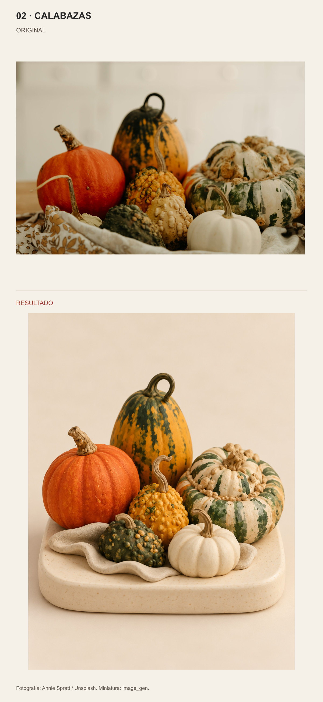
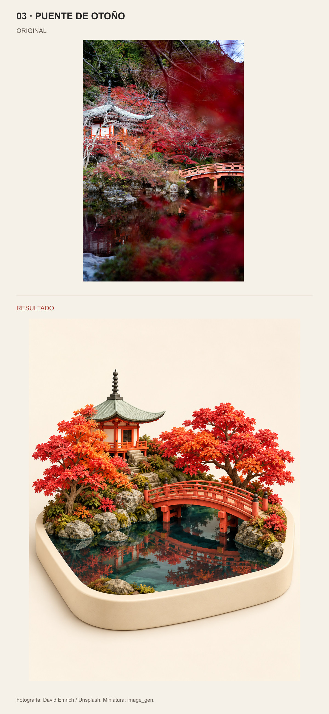

# Foto a miniatura

Cada muestra presenta la referencia original arriba y el resultado debajo, sin recortar ni deformar las imágenes. Los rótulos visuales están en español.

[Skill](SKILL.md) · [Galería de comparación](comparison.html)

## 01 · COSECHA

Fotografía: Misky / Unsplash. Miniatura: image_gen.

## 02 · CALABAZAS

Fotografía: Annie Spratt / Unsplash. Miniatura: image_gen.

## 03 · PUENTE DE OTOÑO

Fotografía: David Emrich / Unsplash. Miniatura: image_gen.

## Uso

Coloca la carpeta completa de este skill en tu directorio de skills y utiliza `$photo-miniature-diorama`. Revisa SKILL.md antes de ejecutarlo. La carpeta no incluye modelos ni credenciales.

[Fuentes y condiciones](references/sources.md) · [Prompts y corrección de material](references/prompts.md). Las miniaturas son imágenes generadas, no archivos de malla 3D.
